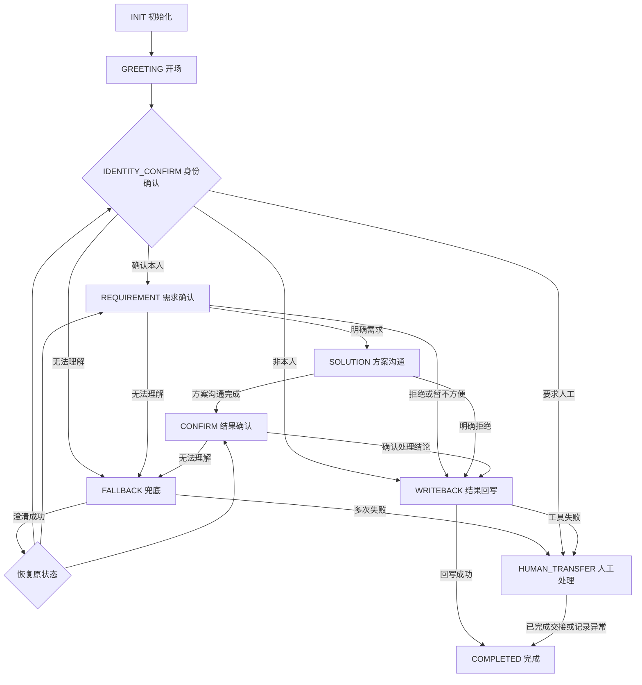

# B组 Agent 状态机设计草案

## 一、业务场景与设计目标

### 1.1 业务场景

本项目面向智能语音外呼客服场景，构建能够理解客户需求、管理对话流程、调用业务工具并完成任务闭环的 Agent 系统。

系统接收 A 组语音识别模块提供的客户文字信息，通过意图识别、槽位提取和状态机判断，决定下一步业务操作，必要时调用模拟业务接口，并将最终处理结果结构化回写。

在比赛官方具体业务资料公布前，暂以模拟会员服务外呼场景进行设计，使用合成数据，不涉及真实客户信息或真实电话外呼。

### 1.2 设计目标

1. **规范对话流程：** 按照自报身份、身份确认、需求确认、方案沟通、结果确认和结果回写的基本流程推进任务。

2. **准确理解客户需求：** 识别客户的意图，提取身份、需求、方案选择和最终决定等关键信息。

3. **支持异常情况处理：** 对身份不符、客户拒绝、暂时不方便、无法理解、要求转人工等情况设置对应处理流程。

4. **实现业务工具调用：** 根据实际业务需求调用客户查询、订单查询、工单登记和结果回写工具。

5. **保证业务合规：** 避免虚假承诺、隐私泄露、违规推销和未经确认的业务操作。

6. **实现结果可追溯：** 保存对话状态、关键业务信息及工具执行结果，支持后续测试与评估。

### 1.3 B组职责范围

B组主要负责 Agent 的业务决策和执行逻辑，包括对话状态机、Prompt设计、意图识别、槽位管理、工具调用及业务结果回写。

A组负责实时语音识别、合成和交互；C组负责系统工程集成、基础设施、日志与评测。B组需要按照团队接口协议与其他模块进行联调。

## 二、对话状态机设计

### 2.1 状态定义与转换规则

系统采用有限状态机（FSM）管理外呼对话流程。每个状态具有明确的业务目标、执行条件和允许的下一状态。

| 状态名称 | 业务作用 | 转换条件 | 下一状态 |
|---|---|---|---|
| INIT | 初始化会话 | 会话建立成功 | GREETING |
| GREETING | 自我介绍 | 完成规定开场话术 | IDENTITY_CONFIRM |
| IDENTITY_CONFIRM | 确认客户身份 | 确认本人 | REQUIREMENT |
| REQUIREMENT | 了解客户需求 | 需求已明确且适合继续沟通 | SOLUTION |
| SOLUTION | 根据规则介绍方案 | 方案沟通完成 | CONFIRM |
| CONFIRM | 确认客户最终决定 | 获得明确决定或确定处理结论 | WRITEBACK |
| WRITEBACK | 保存业务处理结果 | 数据回写成功 | COMPLETED |
| COMPLETED | 结束业务流程 | 已完成或终止 | 无 |
| FALLBACK | 处理无法理解、信息不完整等情况 | 澄清成功或达到失败阈值 | 恢复原状态或 HUMAN_TRANSFER |
| HUMAN_TRANSFER | 处理需要人工介入的情况 | 记录转人工结果并完成交接或兜底 | WRITEBACK 或结束处理 |

### 2.2 异常情况处理

**情况一：身份不符**

客户明确表示不是目标联系人时，不得继续透露业务信息。系统记录身份不符或错号，执行必要的结果回写后礼貌结束。

**情况二：客户拒绝**

客户明确拒绝服务时，不得强行推销。系统按照合规规则停止推进业务，记录拒绝意向及原因，完成结果回写。

**情况三：客户暂时不方便**

客户表示正在开车、开会等情况时，暂停业务沟通。根据客户意愿和业务规则判断是否需要后续联系，不得将暂时不方便直接判定为拒绝。

**情况四：无法理解客户回答**

当识别结果不明确或缺少必要信息时，进入 FALLBACK，主动澄清。澄清成功后恢复原业务状态；连续失败达到规定次数时进入人工处理或其他兜底流程。

**情况五：客户要求人工服务**

客户明确要求人工服务时，停止自动业务推进，进入 HUMAN_TRANSFER。只有在真实转接成功时才能告知客户已经转接成功，否则应如实说明并记录待处理结果。

**情况六：工具调用失败**

当业务接口超时、返回错误或不可用时，不得虚构操作成功。系统记录错误，按照重试与兜底策略处理，必要时转人工。

### 2.3 状态转换约束

1. 仅允许按照业务规则进行状态转换。
2. 必须满足相应业务条件后才能进入下一状态。
3. 状态转换前应检查必要槽位是否完整。
4. 异常状态需要保留原状态信息，便于恢复流程。
5. 所有业务终止分支均应记录相应的最终处理结果。
6. 工具执行结果必须经过确认，不得仅依靠大模型文字判断操作是否成功。

上述内容为B组状态机设计草案，需与团队现有 fsm.py、会话管理和数据库接口进一步对齐。

### 2.4 状态机流程图

以下流程图展示 Agent 的正常业务流程及主要异常处理路径。具体状态转换需要在后续开发中与现有 Python 代码、会话管理和业务接口进一步对齐。

**设计说明：**

1. 正常情况下，Agent 按照身份确认、需求确认、方案沟通、结果确认和结果回写的流程执行。
2. 身份不符、拒绝服务和暂时不方便等情况，应根据业务规则记录对应结果，不得强制推进正常业务。
3. FALLBACK 负责处理无法理解的情况，澄清成功后返回之前的业务状态；反复失败时进入人工处理。
4. 工具调用失败时不能虚构处理成功，必须记录异常并执行兜底策略。
5. 所有异常路径均需在后续代码中补充必要的状态校验和结果记录。

## 三、槽位定义与管理规则

### 3.1 槽位定义表

槽位（Slot）用于保存 Agent 在对话过程中提取的关键业务信息，为客户意图识别、对话状态转换、业务工具调用及最终结果回写提供数据支持。

根据当前项目 `server/agent/fsm.py` 文件中的 `SLOT_SCHEMA`，系统定义以下六项槽位：

| 槽位名称 | 中文含义 | 允许值或数据格式 | 当前代码标记 |
|---|---|---|---|
| customer_identity | 客户身份确认结果 | confirmed / denied / unclear | required=True |
| customer_need | 客户具体需求 | 自由文本 | required=True |
| selected_plan | 客户选择的方案 | renew_9off / decline / defer | required=True |
| customer_decision | 客户最终意愿 | agree / refuse / need_think | required=True |
| followup_required | 是否需要后续跟进 | true / false | required=True |
| final_status | 最终业务处理结果 | 已登记工单 / 拒绝-已记录原因 / 错号 / 转人工 | required=True |

### 3.2 槽位提取与更新规则

1. **槽位初始化：** 对话开始时，系统初始化槽位信息。尚未获得客户确认的内容应保持未填写状态，不得自行编造。

2. **信息提取：** 每轮客户输入经过意图识别后，系统提取其中与业务相关的信息，并转换为对应槽位允许的数据格式。

3. **信息更新：** 当客户提供新的有效信息时，系统更新对应槽位。对于含义不明确或前后矛盾的回答，应先进行澄清，不得擅自确定客户意愿。

4. **状态关联：** 槽位信息用于辅助状态机判断。系统应根据当前对话状态、客户意图及已获取的业务信息决定下一步操作。

5. **分支校验：** 当前代码将六项槽位均标记为 `required=True`，但不同业务分支所需的信息可能不同。例如客户身份不符时，不应继续要求其提供续费方案。后续开发需要根据业务分支设计具体校验规则。

6. **结果记录：** 当客户明确同意、拒绝或需要人工处理时，系统应记录相应业务结果。对于需要调用工具的操作，只有获得真实的工具执行结果后，才能确认操作成功。

7. **数据安全：** 槽位仅保存业务处理所必需的信息，不得擅自收集、生成或泄露客户敏感信息。

### 3.3 槽位提取示例

以下使用模拟会员服务场景说明槽位的提取与更新过程。

| 客户回答 | 对应槽位 | 提取结果 |
|---|---|---|
| 是的，我是本人。 | customer_identity | confirmed |
| 我想了解一下会员续费。 | customer_need | 会员续费咨询 |
| 我想办理九折续费方案。 | selected_plan | renew_9off |
| 可以，我同意办理。 | customer_decision | agree |
| 我暂时不办理，之后再考虑。 | selected_plan | defer |
| 不用了，请不要再联系我。 | selected_plan | decline |
| 我希望转人工客服。 | final_status | 转人工（待实际处理确认） |

上述示例展示的是设计阶段预期的槽位提取结果，并不代表当前程序已经实现全部识别和处理逻辑。

### 3.4 后续开发注意事项

1. 本节槽位名称及允许值与当前 `fsm.py` 中的 `SLOT_SCHEMA` 保持一致。
2. `required=True` 为当前代码中的字段配置，具体业务分支的必填条件仍需进一步设计与实现。
3. 预约时间等额外字段暂未纳入现有槽位定义，后续如有业务需求，应同步修改代码和文档。
4. 槽位提取结果必须经过规则校验，不能直接将大模型返回的所有内容视为可靠业务数据。
5. 槽位设计及业务规则需根据比赛正式业务资料和团队接口协议进行调整。

